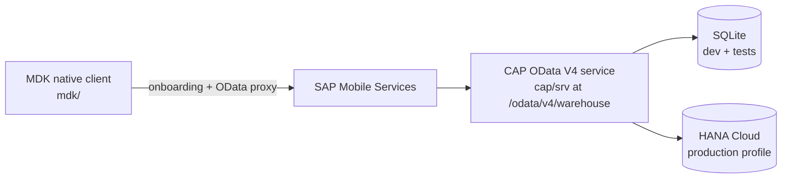

# Warehouse Lens

A native mobile app for warehouse employees: scan a material's QR code, see where stock is available, and submit an internal transfer request in under a minute. Built with SAP MDK (metadata-driven native client) on top of a CAP TypeScript OData V4 backend.

## What it does

A warehouse employee at one site often finds a bin empty while another site has plenty. Warehouse Lens turns that discovery into a tracked transfer request:

1. **Scan** a material QR code with the device camera (or type the code manually).
2. **View material details** and the stock level at the employee's home warehouse.
3. **Find availability** at the other warehouses, sorted by available quantity.
4. **Select a source warehouse** to request stock from.
5. **Submit a transfer request** with quantity and an optional note (idempotent, server-validated).
6. **Track the request** on a status timeline and in a searchable, filterable request list.

## Demo story

Alex (mock user `alex`, home warehouse Cairo/CAI) scans **MAT-1042 "Precision bearing"**. Cairo has 0 available (reorder point 10). Find stock shows availability (`onHand - reserved`) elsewhere:

| Warehouse | On hand | Reserved | Available |
| --- | --- | --- | --- |
| Alexandria (ALX) | 250 | 10 | 240 |
| Giza (GIZ) | 70 | 5 | 65 |
| Suez (SUZ) | 20 | 2 | 18 |

Alex requests 20 EA from Alexandria to Cairo. The backend persists the request (e.g. `TR-001006`) with status `AWAITING_APPROVAL` and a `SUBMITTED` event; the confirmation screen shows the real reference and a timeline (Submitted done, Awaiting approval current, Dispatch and Received pending). This exact flow is verified locally via automated tests and a live HTTP smoke test.

## Architecture



- **MDK client** (`mdk/`): 7 metadata-driven pages (Home, Scan, MaterialDetails, FindStock, Review, RequestDetail, Requests), native barcode scanning, online-only OData.
- **SAP Mobile Services**: app registration, onboarding, and destination that forwards to the CAP service (app and destination configured on a BTP trial; client onboarding not yet run - see status below).
- **CAP backend** (`cap/`): TypeScript service handler with validation, idempotent submission, transactional reference numbering, and role-based access (`WarehouseUser` / `WarehouseAdmin`).
- **Database**: SQLite file for dev (persists across restarts), in-memory for tests, HANA Cloud (hdi-shared) via `mta.yaml` for the production profile.

## Scope boundary

Warehouse Lens is a transfer **request** app, deliberately scoped as an MVP. Submitting a request does **not** approve it, dispatch stock, reserve stock, or decrement inventory, and nothing is posted to SAP S/4HANA — goods-movement posting is a future extension point only. Because pending requests do not reserve stock, multiple pending requests can together exceed what is available; a future approval step must revalidate availability and reserve transactionally. The backend enforces this boundary: the only write path is the `submitTransferRequest` action, and stock levels, request status, and events are read-only through the API.

## Stack

| Component | Version |
| --- | --- |
| Node.js | 22 LTS recommended (CI); local dev verified on 24.18.0; engines `>=20` |
| @sap/cds | 9.9.x (with @sap/cds-dk 9) |
| @cap-js/sqlite | ^2 |
| @cap-js/hana | ^2.8 (cds-9-compatible major) |
| @sap/xssec | ^4 |
| TypeScript / tsx | ^5 / ^4 (dev runtime via `cds-tsx`) |
| jest / ts-jest | ^29 / ^29 |
| @cap-js/cds-types | ^0.19 |
| MDK metadata schema | 26.6 (current MDK client 26.6) |
| @sap/mdk-tools | ^1.16.0 (requires Node >= 22.13; installed at repo root) |

Lockfiles are committed. Note: `@sap/mdk-tools` is intentionally installed at the repo root, never inside `mdk/`, because the validator and bundler scan everything in the project folder including `node_modules`.

## Quick start

Backend (CAP service on port 4004):

```bash
git clone <this-repo>
cd warehouse-lens/cap
npm install
npm run seed     # deploy schema to db.sqlite + seed demo data (idempotent)
npm run watch    # http://localhost:4004, mocked auth (users: alex, dana, sam, kim, bob)
```

Run the backend tests and checks:

```bash
cd cap
npm test             # 41 jest tests against an in-memory database
npm run typecheck    # tsc --noEmit
npm run build        # cds build --production + TypeScript precompile to gen/srv
```

MDK client validation and bundling (from the repo root):

```bash
cd warehouse-lens
npm install
npm run mdk:validate   # see "Implementation status" for the 9 documented false positives
npm run mdk:bundle     # produces mdk/.build/uploadBundle.zip for Mobile Services
```

Demo helpers (dev-only, guarded against non-local environments):

```bash
cd cap
npm run demo:reset                          # delete cap/db.sqlite and reseed
npm run demo:advance TR-001004              # simulate a status progression (labeled [SIMULATED])
npm run demo:advance TR-001004 -- --reject "reason"
```

## Documentation

- [docs/architecture.md](docs/architecture.md) - system context, auth flow, submission/idempotency sequence, business-rule boundaries
- [docs/local-development.md](docs/local-development.md) - prerequisites, seeding, backend startup, MDK tooling, Android setup, troubleshooting
- [docs/design.md](docs/design.md) - design system, screen designs, and MDK-specific deviations
- [docs/testing.md](docs/testing.md) - automated test inventory and the manual on-device checklist
- [docs/btp-deployment.md](docs/btp-deployment.md) - BTP / Mobile Services / HANA deployment guide (backend deployment executed on a BTP trial)
- [docs/demo-script.md](docs/demo-script.md) - 45-60 second demo recording script
- [assets/qr-labels/print-sheet.html](assets/qr-labels/print-sheet.html) - printable QR labels for scanning demos (per-material PNGs/SVGs alongside)

## Implementation status

Honesty section: this is a portfolio project, and the line between verified and unverified matters.

**Verified locally (Windows, Node 24):**

- 41/41 jest tests green, covering every spec case: quantity validation (zero, negative, fractional, oversized), unknown/inactive material and warehouse, source = destination, insufficient availability, availability changed at submit time, idempotent replay (identical payload returns the same request with `replayed=true`), same-key-different-payload 409, concurrent duplicate submissions producing exactly one request, unauthorized submit 403, cross-user access denial (including navigation paths), atomic deep insert with forced-failure rollback including the reference counter, dashboard counts, scan history dedup/bounds/scoping, rejected writes on stock/status/events, filters, search, pagination, and ordered timeline events.
- `tsc --noEmit` clean; `cds build --production` plus TypeScript precompile emits runnable JS; `npm run seed` and `npm run demo:reset` work.
- Live HTTP smoke test against `cds watch`: dashboard counts, MAT-1042 lookup, find-stock ordering (ALX 240 / GIZ 65 / SUZ 18), submit 20 EA producing `TR-001006` in `AWAITING_APPROVAL`, identical replay returning the same reference with `replayed=true`, pending count incrementing.
- `mdk validate`: 9 errors remain, all documented false positives - the validator checks each `CallFunction` against the union of non-nullable parameters of *all* OData actions in the EDMX, so the dashboard and scan actions are flagged for `submitTransferRequest`'s parameters. The EDMX itself is correct CSDL. CI fails on any *other* validation error.
- `mdk build --target zip` succeeds (webpack rule bundle, NSS style compile, i18n, binding cross-references) and produces `mdk/.build/uploadBundle.zip`.
- CI (`.github/workflows/ci.yml`) runs all of the above on ubuntu / Node 22 without any SAP credentials.

**Deployed to an SAP BTP trial (September 2026, Cloud Foundry, AWS US East):**

- `mbt build` produced the `.mtar`; `cf deploy` created the XSUAA instance (role collections `WL Warehouse User` / `WL Warehouse Supervisor`), an HDI container on an SAP HANA Cloud (`hana-free`) instance, and the destination service instance, then ran the HDI deployer task (**succeeded** - tables and master data loaded into HANA) and started `warehouse-lens-srv`.
- An unauthenticated request to the deployed service returns `401` - XSUAA protection is enforced. A role collection was assigned to a real user.
- A Mobile Services MDK app and its `WarehouseLens` destination (Forward Authentication) were created and configured.
- Trial resources are ephemeral: free-tier HANA Cloud and trial apps stop automatically, so this is a verified deployment, not a permanently running instance.

**Not verified yet:**

- No native Android/iOS runtime run: the MDK metadata has not been deployed to Mobile Services, no device has been onboarded, and no app screenshots exist. Camera scanning, Stepper appearance, the dynamic FindStock toolbar title, and page-load timing against service initialization are untested on a device (fallbacks are documented where relevant).
- No authenticated OData read against the BTP deployment has been observed (the backend has no approuter, so a browser gets `401` by design; the MDK client is the intended authenticated consumer). Data presence in HANA is evidenced by the successful deployer task, and every business rule is covered by the automated tests against SQLite.
- No screen mockup file was provided; the visual design was implemented from the written design-system spec (colors, spacing, hierarchy, one primary action per screen). `docs/design.md` lists the MDK-specific deviations.

## Limitations

- **Online-only**: `OfflineEnabled` is false by design; availability checks and submission require a connection, and the client shows clear offline messages instead of syncing.
- **Bounded lists**: the request list loads at most 50 requests (`$top=50`, newest first) with server-side search and status filtering; scan history is bounded to the 10 most recent per user.
- **Pending requests do not reserve stock**: availability is rechecked server-side at submit time, but nothing is held afterward, so pending requests can collectively oversubscribe a warehouse.
- **Demo auth in dev**: local development uses CAP mocked authentication with fixed users (`alex`, `dana`, `sam`, `bob`); XSUAA with real role collections applies to the production profile (deployed on a BTP trial, see above).
- **Local backend and phones**: a phone cannot reach `localhost` on the dev machine - use the machine's LAN IP (with the mocked-auth basic credentials) or deploy to BTP for on-device tests.

## License

MIT - see [LICENSE](LICENSE).
