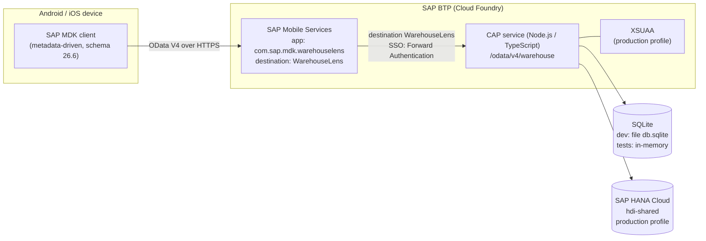
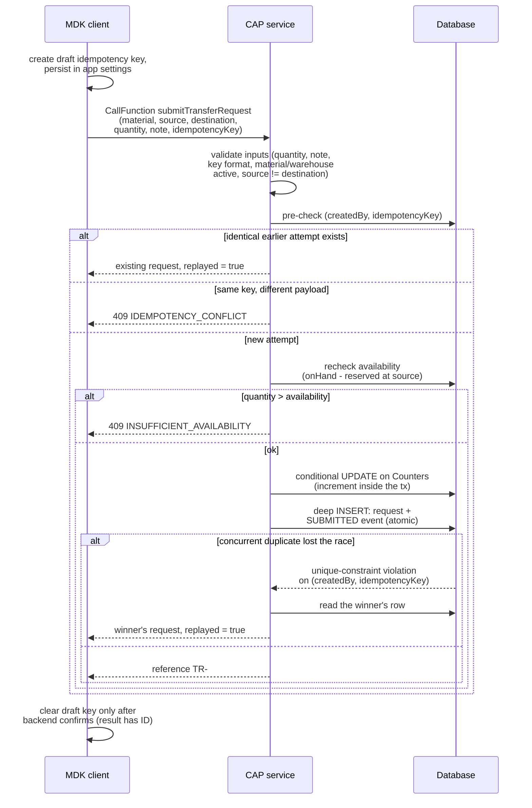

# Architecture

Warehouse Lens is a mobile app for warehouse employees: scan a material QR code,
check availability at other warehouses, and submit an internal transfer request.
This document describes the system context, the security model, the data model,
and the design decisions behind the submission path.

## System context

- The MDK client is online-only (`OfflineEnabled: false` in
  `mdk/Services/WarehouseService.service`); it shows clear messages when
  availability checks or submission need a connection.
- The CAP service (`cap/`) exposes exactly one OData V4 service,
  `WarehouseService` at `/odata/v4/warehouse` (`cap/srv/warehouse-service.cds`).
- Persistence is profile-driven: SQLite in development and tests, HANA Cloud
  in the production profile (`mta.yaml`: modules `warehouse-lens-srv` and
  `warehouse-lens-db-deployer`, resource `warehouse-lens-db`).
- The BTP path (Mobile Services registration, destination, HANA deployment,
  XSUAA login) is configured but has not been deployed in this project; see
  the verification notes in the README and `docs/btp-deployment.md`.

## Authentication flow

Development and production differ only in who authenticates the user; the
service code is identical.

**Development (mocked auth).** `cds` mocked authentication provides the users
`alex` (WarehouseUser, Cairo), `dana` (WarehouseUser, Alexandria), `sam`
(WarehouseUser + WarehouseAdmin, Cairo), and `bob` (no roles, used to verify
403 responses).

**Production (XSUAA).**

1. The MDK client onboards against SAP Mobile Services
   (app `com.sap.mdk.warehouselens`), which drives the XSUAA login.
2. Mobile Services forwards each OData call through the `WarehouseLens`
   destination with SSO set to "Forward Authentication", so the user's token
   travels to the CAP service.
3. The CAP service validates the JWT (`@sap/xssec`) and derives the identity
   from `req.user`. The `createdBy` value on a transfer request is always set
   server-side from `req.user.id`, never accepted from the client.
4. Roles come from `cap/xs-security.json`: scopes `WarehouseUser` and
   `WarehouseAdmin`, with role collections "WL Warehouse User" and
   "WL Warehouse Supervisor".

The whole service requires `WarehouseUser` (`@requires: 'WarehouseUser'`).
`TransferRequests`, `RequestEvents`, and `RecentScans` are additionally
restricted so a `WarehouseUser` reads only their own rows (for events via the
path expression `request.createdBy = $user`), while `WarehouseAdmin` reads all.

## Data model summary

Defined in `cap/db/schema.cds`, namespace `wl`.

| Entity | Purpose | Key constraints |
| --- | --- | --- |
| `Materials` | Master data incl. `baseUnit`, `active` flag | unique `materialCode` |
| `Warehouses` | Sites (CAI, ALX, GIZ, SUZ) | unique `code` |
| `Stocks` | On-hand and reserved quantities per site | unique `(material, warehouse)` - one row per material + warehouse |
| `TransferRequests` | The request itself, status enum `AWAITING_APPROVAL` .. `REJECTED` | unique `reference`; unique `(createdBy, idempotencyKey)` |
| `RequestEvents` | Append-only status timeline per request | composition of `TransferRequests` |
| `EmployeeProfiles` | `userId` -> home warehouse | unique `userId` |
| `RecentScans` | Server-side per-user scan history | unique `(userId, material)`, bounded to 10 |
| `Counters` | Internal reference numbering | never exposed via the service |

Availability is never stored; it is always derived as
`onHandQuantity - reservedQuantity` (the `StockAvailability` view exposes it as
`availableQuantity`). The service is read-only except for three actions:
`submitTransferRequest`, `getDashboard`, and `recordScan`. `idempotencyKey` and
`payloadFingerprint` are excluded from the `TransferRequests` projection.

## Submission and idempotency

The only write path is the `submitTransferRequest` action. The client persists
a draft idempotency key in app settings (NativeScript `appSettingsModule`), so
the key survives an app kill mid-submit; a retry of the identical payload
replays instead of duplicating.

Properties verified by the test suite (40 Jest tests, plus a live HTTP smoke
test against `cds watch`):

- An identical retry returns the same request with `replayed: true` - same
  reference, no second row.
- The same key with a different payload is rejected with 409
  `IDEMPOTENCY_CONFLICT` (editing the payload on the client resets the key,
  which correctly makes it a new attempt).
- Two concurrent submissions with the same key produce exactly one request;
  the loser catches the unique-constraint violation and replays the winner.
- Request and SUBMITTED event are created in a single deep insert inside the
  request transaction; a forced-failure test proves full rollback, including
  the counter increment.

## What submit does NOT do (business-rule boundary)

`submitTransferRequest` creates a request in status `AWAITING_APPROVAL` and
nothing else. It does not:

- approve, dispatch, or receive anything;
- reserve stock or decrement `onHandQuantity` / `reservedQuantity`;
- post any goods movement to SAP S/4HANA.

Consequence, by design: multiple pending requests can together exceed the
available quantity at a source warehouse. The submit-time availability check
is a usability guard against obviously impossible requests, not a reservation.
A future approval step must revalidate availability and reserve stock in one
transaction; only then would over-commitment be prevented. The service exposes
no create/update/delete on `Stocks`, request `status`, or `RequestEvents`, so
no client can fake that step (verified: write attempts are rejected with 405).

## Reference-number generation

References look like `TR-001006` and come from a dedicated `Counters` row that
is incremented via a conditional `UPDATE` inside the request transaction.

Why not `SELECT max(reference) + 1`? Two concurrent submissions would read the
same maximum and generate the same reference; the unique constraint would then
fail one of them for the wrong reason. The conditional update serializes
writers on the counter row (row lock on HANA, transaction serialization on
SQLite), and because it runs inside the request transaction, a rollback
returns the number along with everything else. Small numbering gaps can still
occur - a concurrent duplicate submission that ends as an idempotent replay
commits its increment without creating a request - and are acceptable:
references must be unique, not dense. The counter row is created on first use
rather than seeded from a `db/data` CSV, because initial-data artifacts are
re-imported on HANA redeployments and would reset a live counter. Numbering
starts at 1001, so the first seeded demo reference is TR-001001.

## Error codes

Every business error carries a machine-readable `code` in the OData error
body, so the client can react without parsing messages.

| Code | HTTP | Meaning |
| --- | --- | --- |
| `INVALID_QUANTITY` | 400 | Not a positive integer, or above the sanity cap of 100000 |
| `NOTE_TOO_LONG` | 400 | Note exceeds 200 characters |
| `INVALID_IDEMPOTENCY_KEY` | 400 | Key does not match `^[A-Za-z0-9._-]{8,64}$` |
| `MISSING_PARAMETER` | 400 | A required action parameter is absent |
| `SOURCE_EQUALS_DESTINATION` | 400 | Source and destination warehouse are the same |
| `MATERIAL_NOT_FOUND` | 404 | Unknown material ID |
| `MATERIAL_INACTIVE` | 400 | Material exists but is flagged inactive |
| `WAREHOUSE_NOT_FOUND` | 404 | Unknown source or destination warehouse |
| `WAREHOUSE_INACTIVE` | 400 | Warehouse exists but is flagged inactive |
| `INSUFFICIENT_AVAILABILITY` | 409 | Quantity exceeds current availability; message includes the current value |
| `IDEMPOTENCY_CONFLICT` | 409 | Same idempotency key, different payload |

## Future extension point: S/4HANA integration (NOT implemented)

Nothing in this MVP talks to SAP S/4HANA, and no goods movements are posted
anywhere. The intended extension point is destination-based: the deployment
already binds a BTP Destination service instance (`warehouse-lens-destination`
in `mta.yaml`), so a future approval/dispatch flow could call an S/4HANA API
(for example a stock transfer posting) through a configured destination
without changing the mobile client or the service contract. The natural hook
is the approval step described above: revalidate, reserve, then post - all
server-side. To be explicit: this is a documented direction only; no such
integration exists, and none of it has been built or tested.
